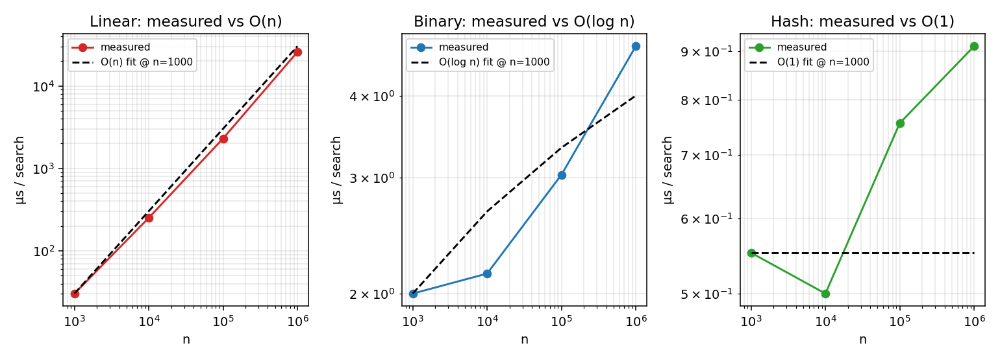
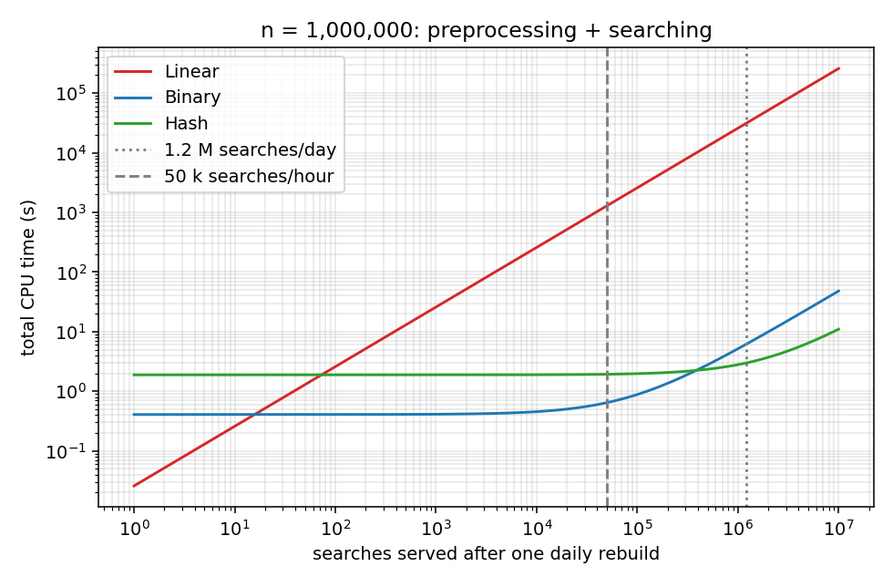

# Analysis (Tasks 2–7, 10–12)

# Task 2 – Identify the Basic Operation (2 marks)

A basic operation is the operation executed most often *and* whose count is proportional to total running time. In every search algorithm the work is dominated by **key comparisons** – each comparison is followed by a constant amount of bookkeeping (index update, branch), so total time = (number of comparisons) × constant.

| Algorithm | Basic operation | Where it occurs | How its count grows with n |
|---|---|---|---|
| Linear | `A[i] = x` | Inside the `for` loop body, once per iteration | Up to n times; the loop runs until the key is found, so the count depends directly on the key's position – grows **linearly** with n |
| Binary (recursive) | `A[mid] = x` (3-way comparison of the key with the middle element) | Once per recursive call | Each call halves the range, so the number of calls (= comparisons) is ⌊log₂ n⌋ + 1 at most – grows **logarithmically**: 1,000 → ≈10, 1,000,000 → ≈20 |
| Hash | `key = x` (stored key vs. search key) | Inside the loop that walks the chain of one bucket | The chain length is the load factor α = n/m (a constant, 0.75) on average, *not* a function of n – grows **not at all** (expected) |

**Why comparisons are appropriate.**
* Every algorithm must perform them to decide membership; they cannot be skipped.
* They are machine-independent, so the count can be derived mathematically (Task 3) and measured exactly (Task 9) and compared against wall-clock time (Task 10).
* For the hash approach the hash computation `h(x)` is a constant-cost step done once per search, so it does not alter the growth rate; the chain comparisons capture the only part that could depend on n (through collisions).
* For binary search the sort used in preprocessing is also a comparison sort, so comparisons remain the right unit to charge for preprocessing; for hash preprocessing the basic operation is the *insertion* (one hash + one append).

---

# Task 3 – Mathematical Derivation of Time Complexity (6 marks)

Input size: **n** = number of records. Basic operation: key comparison (Task 2). Let C(n) denote the number of comparisons for **one search**, and q the number of searches performed.

---
## 3.1 Linear search
**Worst case** (key in last position, or absent): the loop body executes for i = 0 … n-1:

C_worst(n) = Σ_{i=0}^{n-1} 1 = **n**

**Best case**: key at index 0 → C_best = 1.

**Average case.** Let p be the probability the key is present (successful search) and, if present, equally likely at each of the n positions. A key at position i (1-based) costs i comparisons:

C_avg(n) = p · (1/n) Σ_{i=1}^{n} i + (1-p) · n = p · (n+1)/2 + (1-p) · n

* Successful search only (p = 1): C_avg = (n+1)/2
* Unsuccessful only (p = 0): C_avg = n

Time function: T(n) = c · C(n) → T_worst(n) = c·n, a linear function.
**Preprocessing:** 0. **Total for q searches:** q·(n+1)/2 (avg) … q·n (worst) = Θ(q·n).

---
## 3.2 Binary search (recursive)
Let C(n) count comparisons on a sorted array of n elements. One comparison is made, then at most one recursive call on ≤ ⌊n/2⌋ elements:

C_worst(n) = C_worst(⌊n/2⌋) + 1, C_worst(1) = 1  (derived in Tasks 6–7)

Solution: C_worst(n) = **⌊log₂ n⌋ + 1**.
* n = 1,000 → 10; n = 1,000,000 → 20.

**Best case:** key at the first mid → 1 comparison.

**Average (successful).** Take n = 2^k − 1 so the decision tree is a perfect binary tree of k levels; level i has 2^{i-1} nodes and each costs i comparisons:

C_avg(n) = (1/n) Σ_{i=1}^{k} i·2^{i-1} = ((k−1)·2^k + 1)/n ≈ k − 1 = **log₂(n+1) − 1 ≈ log₂ n − 1**

(using Σ_{i=1}^{k} i·2^{i-1} = (k−1)2^k + 1.) For an unsuccessful search almost every path reaches full depth: C ≈ ⌊log₂ n⌋ + 1.

**Preprocessing (sorting).** A comparison sort needs ≥ ⌈log₂ n!⌉ ≈ n·log₂ n − 1.44 n comparisons; merge sort satisfies M(n) = 2M(n/2) + (n−1), giving M(n) ≤ n·log₂ n − n + 1, i.e. Θ(n log n).

**Total for q searches:** T_total(n, q) = Θ(n log n) + q·Θ(log n) = Θ((n + q) log n).

---
## 3.3 Hash table (separate chaining, load factor α = n/m = 0.75)
**Preprocessing.** Each of the n insertions costs one hash evaluation + one append, a constant: B(n) = n·c₁ → **Θ(n)** expected (the n elements are inserted once; no resizing needed because m is chosen in advance).

**Search.** Under simple uniform hashing each key is equally likely to land in any of the m buckets, so the expected chain length is n/m = α.
* Unsuccessful search: examines the entire chain → E[C] = **α** = 0.75
* Successful search: the sought element is, on average, in the middle of its chain; the expected number of comparisons is 1 + (α/2) − α/(2n) ≈ **1 + α/2 = 1.375**
Both are independent of n ⇒ T_search(n) = **Θ(1)** expected.

**Worst case.** If all n keys collide into one bucket, the chain has length n ⇒ C_worst = n, i.e. O(n). With a good hash this is extremely unlikely (experiment: maximum chain = 7 at n = 1,000,000).

**Total for q searches:** T_total(n, q) = Θ(n) + q·Θ(1) = Θ(n + q).

---
## 3.4 Combined cost (preprocessing + searching)

| Approach | Preprocessing | One search (avg) | q searches |
|---|---|---|---|
| Linear | 0 | (n+1)/2 | Θ(q·n) |
| Binary | Θ(n log n) | ≈ log₂ n − 1 | Θ(n log n + q log n) |
| Hash | Θ(n) | 1 + α/2 | Θ(n + q) |

**Break-even reasoning.** Binary beats linear when n·log₂ n + q·log₂ n < q·n/2, i.e. q > ≈ 2 log₂ n (≈ 40 searches for n = 10⁶ if sorting were as costly as n log n comparisons; measured, see Task 9/12, ≈ 16 searches). Hash beats binary when n + q < n log n + q log n, i.e. for all q at large n in comparison counts, although hash insertion is more expensive *per element* than a sort comparison, so the measured break-even is a few hundred thousand searches (Task 12).

---

# Task 4 – Best, Average and Worst-Case Analysis (4 marks)

## Linear search
| Case | Input condition | Operations | Why |
|---|---|---|---|
| Best | key is `A[0]` | 1 | First comparison succeeds; the loop exits immediately |
| Average | key present, uniformly likely at any of n positions | (n+1)/2 | On average the scan covers half the list. Measured: 483,964 at n=10⁶ (theory 500,000.5; the difference is sampling noise of the random keys) |
| Worst | key in last position **or absent** | n | Nothing allows early exit, every element is inspected. Measured: exactly 1,000,000 |

## Binary search
| Case | Input condition | Operations | Why |
|---|---|---|---|
| Best | key equals the middle element of the whole array | 1 | The very first probe succeeds |
| Average | key present, every position equally likely | ≈ log₂ n − 1 | Half of all elements sit at the deepest two levels of the implicit decision tree, so the typical key is found only one level above the bottom. Measured 18.91 at n=10⁶ vs log₂(10⁶) − 1 = 18.93 |
| Worst | key absent (or found at a leaf of the decision tree) | ⌊log₂ n⌋ + 1 | The range is halved until it is empty, so the full depth is traversed. Measured 19.95 vs 20 |

Binary search is *input-insensitive*: the best case (a single specific key) is rare and the average and worst cases differ by ~1 comparison; its performance depends on n only.

## Hash-table search
| Case | Input condition | Operations | Why |
|---|---|---|---|
| Best | key's bucket holds exactly that key (chain length 1), or the bucket is empty for an absent key | 1 (0 for an empty bucket) | No collision |
| Average | uniform hash, load factor α = 0.75 | successful ≈ 1 + α/2 = 1.375 (measured 1.40); unsuccessful ≈ α = 0.75 (measured 0.79) | Chain length is Poisson-like with mean α; an unsuccessful search must scan the whole chain, a successful one on average half of it. About e^{-0.75} ≈ 47% of buckets are empty and cost no comparison at all, which is why misses can be *cheaper* than hits |
| Worst | all keys hash to the same bucket (degenerate / adversarial hash) | n | One chain contains all records and the search degrades to linear search. Not observed: maximum chain was 7 at n=10⁶ |

## Preprocessing cases
* Sort: Θ(n log n) in all cases for merge sort; Timsort (used in the code) is Θ(n) on already-sorted input and Θ(n log n) otherwise – the best case matters if the registration list arrives (mostly) in order.
* Hash build: Θ(n) in all cases (expected); worst case with a bad hash is Θ(n) insertions still – only *searches* degrade.

---

# Task 5 – Asymptotic Analysis (3 marks)

## Notation per algorithm (single search)
| Algorithm | Best | Average | Worst | Tight bound |
|---|---|---|---|---|
| Linear | Ω(1) | Θ(n) | O(n) | Θ(n) for avg/worst; **no single Θ** covers all inputs – the running time is Ω(1) and O(n) |
| Binary (after sort) | Ω(1) | Θ(log n) | O(log n) | Θ(log n) (avg & worst) |
| Hash | Ω(1) | Θ(1) *expected* | O(n) (all keys collide) | Θ(1) expected |

## Preprocessing
| Preprocessing | Notation | Justification |
|---|---|---|
| Sort | Θ(n log n) | merge-sort recurrence T(n) = 2T(n/2) + Θ(n) – Master Theorem case 2 |
| Hash build | Θ(n) | n insertions × Θ(1) |

## Formal checks (definitions)
* Linear avg: (n+1)/2 ≥ n/2 for n ≥ 1 and ≤ n, so c₁ = ½, c₂ = 1, n₀ = 1 ⇒ Θ(n).
* Binary worst: ⌊log₂ n⌋ + 1 ≤ 2 log₂ n for n ≥ 2 and ≥ log₂ n ⇒ Θ(log n).
* Hash expected: 1 + α/2 = 1.375 ≤ 2, a constant ⇒ Θ(1).

## Growth hierarchy
1 ≺ log n ≺ n ≺ n log n:  Hash (1) ≺ Binary (log n) ≺ Linear (n); preprocessing: Hash (n) ≺ Sort (n log n).

## Meaning for 1,000 → 1,000,000 records (×1000)
| Algorithm | Theory: growth factor of comparisons | Interpretation |
|---|---|---|
| Linear | × 1,000 (500 → 500,000) | 1000× more data = 1000× slower; a search that is instantaneous on a department database takes a visible fraction of a second on the university database, and the cost multiplies by the number of requests |
| Binary | × ≈2 (≈10 → ≈20) | Data grows a thousand-fold, work only doubles; each additional factor of 2 in data adds *one* comparison |
| Hash | × 1 | Search cost is flat; but total preprocessing grows ×1000 (Θ(n)) versus ×≈2000 for the sort (n log n) |

For the application: linear search is only viable for tiny tables or one-off searches; both binary and hash scale to 10⁶+ and well beyond (10⁹ records would cost only 30 comparisons for binary search). The asymptotic constants matter only inside a class (e.g. hash is ~5× faster than binary at 10⁶ in practice – Task 10).

---

# Task 6 – Recurrence Relation for the Recursive Approach (3 marks)

Recursive approach: **BinarySearch(A, x, low, high)** (Task 1, Approach 2).

| Component | Identification (from the algorithm) |
|---|---|
| Input size of the original problem | n = high − low + 1 = number of elements still under consideration |
| Size of the recursive subproblem | After computing mid = ⌊(low+high)/2⌋ the algorithm recurses on either `[low, mid−1]` (size ⌊(n−1)/2⌋ = ⌊n/2⌋ − [n even]) or `[mid+1, high]` (size ⌊n/2⌋). In both cases the size is **at most ⌊n/2⌋** |
| Number of recursive calls | **One** – the two branches are mutually exclusive (`if x < A[mid] … else …`); the other half is never examined |
| Work outside the recursive call | Computing `mid` and comparing `x` with `A[mid]` → a constant number of operations: **Θ(1)** (one basic operation) |
| Base case(s) | `low > high` (n = 0): return −1 with no comparison; and n = 1: exactly one comparison then the next calls hit n = 0 |

**Deriving the recurrence.** The time for a problem of size n equals the time for the work done in the current call (constant c) plus the time for the one subproblem of size ⌊n/2⌋:

> **T(n) = T(⌊n/2⌋) + c,  for n > 1,   T(1) = c₀ (T(0) = 0 or constant)**

For comparison counts (worst case, key absent / at deepest level):

> **C(n) = C(⌊n/2⌋) + 1,  C(1) = 1**

**Preprocessing recurrence (merge sort, for completeness).** Sorting makes two recursive calls on halves and merges them with Θ(n) work: S(n) = 2S(⌊n/2⌋) + Θ(n), S(1) = Θ(1).

**Why this is not just a textbook formula.** The coefficient a = 1 (one call) comes from the `if/else` structure, the size ⌊n/2⌋ from the choice of mid, and f(n) = Θ(1) from the fact that the algorithm only compares one element before recursing; changing the algorithm (e.g. ternary split, or scanning half of the range in each call) would change the recurrence.

---

# Task 7 – Solving the Recurrence (4 marks)

Recurrence from Task 6: **C(n) = C(⌊n/2⌋) + 1, C(1) = 1**   (T(n) = T(⌊n/2⌋) + c in general).

## Method 1 – Backward substitution (iteration), n = 2^k
Chosen because the recurrence has a single, regular recursive term with a constant additive cost: unrolling reveals the pattern directly. We assume n = 2^k (smoothness rule: the result extends to all n).

C(n)   = C(n/2) + 1
       = [C(n/4) + 1] + 1 = C(n/4) + 2
       = C(n/8) + 3
       …
       = C(n/2^i) + i

The base case is reached when n/2^i = 1, i.e. i = k = log₂ n:

C(n) = C(1) + log₂ n = 1 + log₂ n

Hence C(n) = **log₂ n + 1** for n = 2^k, and for general n **⌊log₂ n⌋ + 1** ⇒ **Θ(log n)**.

## Method 2 – Master Theorem (verification)
Form T(n) = a·T(n/b) + f(n) with a = 1, b = 2, f(n) = Θ(1) = Θ(n^d), d = 0.
Applicability: a ≥ 1, b > 1 and f(n) is polynomially bounded – satisfied.
Compare f(n) with n^{log_b a} = n^{log₂ 1} = n⁰ = 1.
f(n) = Θ(1) = Θ(n^{log_b a}) → **Case 2**: T(n) = Θ(n^{log_b a} · log n) = Θ(1·log n) = **Θ(log n)**. ✔ matches substitution.

## Method 3 – Substitution (induction proof of the closed form)
Claim: C(n) = ⌊log₂ n⌋ + 1 for all n ≥ 1.
* Base: C(1) = 1 = ⌊log₂ 1⌋ + 1 ✔
* Step: assume true for all m < n. C(n) = C(⌊n/2⌋) + 1 = ⌊log₂ ⌊n/2⌋⌋ + 1 + 1 = (⌊log₂ n⌋ − 1) + 2 = ⌊log₂ n⌋ + 1 ✔ (using ⌊log₂ ⌊n/2⌋⌋ = ⌊log₂ n⌋ − 1 for n ≥ 2).

## Preprocessing recurrence (merge sort): S(n) = 2S(n/2) + n
a = 2, b = 2, f(n) = Θ(n); n^{log₂2} = n; f(n) = Θ(n) → Master Theorem case 2 → **S(n) = Θ(n log n)**.

## Interpretation
* The result Θ(log n) means that **doubling the database adds only one comparison**: n = 1,000 → 10; 10,000 → 14; 100,000 → 17; 1,000,000 → 20 (confirmed experimentally: worst-case counts 9.97, 13.37, 16.67, 19.95).
* The recursion depth is also ⌊log₂ n⌋ + 1 ≤ 20 for 10⁶ records, so recursion causes **no stack-overflow risk**; space complexity is Θ(log n) for the call stack (the iterative form needs Θ(1)).
* Overall cost with preprocessing: Θ(n log n) + q·Θ(log n).

---

# Task 10 – Theory vs. Experiment (4 marks)

## Operation counts agree almost exactly with the derivations
| Quantity (n = 10⁶) | Theory | Measured |
|---|---|---|
| Linear worst (unsuccessful) | n = 1,000,000 | 1,000,000 |
| Linear average (successful) | (n+1)/2 = 500,000.5 | 483,964 (≈3 % low; 40 random queries only) |
| Binary worst | ⌊log₂ n⌋ + 1 = 20 | 19.95 |
| Binary average (successful) | log₂ n − 1 ≈ 18.9 | 18.91 |
| Hash successful | 1 + α/2 = 1.375 | 1.40 |
| Hash unsuccessful | α = 0.75 | 0.79 (0.74–0.79 for all n) |
| Sort + build | n log n / n | 0.41 s vs 1.88 s: ratio sort(10⁶)/sort(10⁵) = 12.5 (theory 12.0 for n log n); build ratio = 21.9 (theory 10) |

The **comparison counts confirm the mathematical analysis**: linear grows ×1000 for ×1000 data, binary grows ≈ +10 comparisons for ×1000 data, hash stays at ≈ 1.4.

## Wall-clock times: same ordering, small deviations
| Algorithm | n = 10³ → 10⁶ time ratio (average) | Theoretical ratio |
|---|---|---|
| Linear | 30.3 µs → 25,864 µs = **×854** | ×1000 |
| Binary | 2.00 µs → 4.76 µs = **×2.4** | ×2 (log₂10⁶ / log₂10³) |
| Hash | 0.55 µs → 0.91 µs = **×1.7** | ×1 |

**Which scales better?** Hash ≻ Binary ≻ Linear for searching; at n = 10⁶ an average search is ≈ 28,000× faster with hash and ≈ 5,400× faster with binary search than with linear search.

## Differences and likely reasons
1. **Linear slightly sub-linear (×854 instead of ×1000):** the small list (n = 10³) is dominated by fixed per-call overhead (function call, timer loop) which is a larger share of its 30 µs; at 10⁶ the cost is memory-bound and purely proportional to n. Worst-case unsuccessful searches at 10⁶ cost 65 ms vs. 25.9 ms average (×2.5, theory ×2) because unsuccessful scans always read the complete list from memory, whereas averages are over early exits that stay in cache.
2. **Binary grows by ×2.4 rather than ×2, hash is not perfectly flat:** at 10³–10⁴ records the whole array/table fits in the CPU caches; at 10⁶ the data (tens of MB of Python objects) exceeds L2/L3 cache, so every probe (each of the ~19 binary probes, and the bucket access of the hash) risks a **cache miss** costing ~100 ns – the RAM-access model "every operation costs the same" is violated. Asymptotic notation hides this cost; the operation *counts* are unaffected.
3. **Absolute times are inflated by the Python interpreter** (≈ 50–100 ns per bytecode); the recursive binary search pays a function call per probe (iterative cross-check: 2.64 µs vs 4.76 µs at 10⁶). A compiled implementation would be 10–50× faster in absolute terms but the *ratios between algorithms* and the growth rates remain.
4. **Hash misses faster than hits** (0.62 µs vs 0.91 µs at 10⁶): ≈ 47 % of buckets are empty (Poisson, α = 0.75) so many unsuccessful searches stop after reading one pointer.
5. **Timing noise:** microsecond-scale measurements vary by ±10–20 % (best-case column at n = 10⁶ for linear shows 0.45 µs vs 0.17 µs elsewhere – a cold cache effect, not an algorithmic one).
6. **Hash build ratio 21.9 vs expected 10** for n 10⁵ → 10⁶: allocation of 1.33 M Python lists and cache-unfriendly random writes make the per-element insertion cost grow with n; the algorithm is still linear in operations (n insertions) but the constant factor is not constant on real hardware.

**Conclusion:** experiments confirm the theoretical growth rates Θ(n), Θ(log n) and Θ(1) in operation counts and, within explainable hardware effects, in time.

---

# Task 11 – Final Design Recommendation (4 marks)

## Recommendation (original scenario: "frequent" lookups, update pattern not specified)
**Keep the registration numbers in a sorted array and use binary search** (Approach 2). The preprocessing sort is paid once and amortised across all subsequent searches.

## Evidence and justification
| Criterion | Linear | **Binary (recommended)** | Hash |
|---|---|---|---|
| Preprocessing (n = 10⁶, measured) | 0 | **0.41 s** | 1.88 s |
| Avg. search (n = 10⁶) | 25,864 µs | **4.76 µs** (19 comparisons) | 0.91 µs (1.4 cmp) |
| Worst-case guarantee | n | **⌊log₂ n⌋+1 = 20 – deterministic** | O(n) (never seen, needs a good hash) |
| Extra memory | none | **none (in place)** | ≈ 1.33 n buckets + chain nodes |
| Supports ordered queries (range, "next registration", prefix such as one batch/year) | no | **yes** | no |
| Break-even vs linear | – | **≈ 16 searches** (0.407 s / (25,864 − 4.76) µs) | ≈ 73 searches |

* **Theory:** Θ(n log n) once + Θ(log n) per search – grows by only one comparison per doubling.
* **Experiment:** one sort (0.4 s for 10⁶ records) pays for itself after ≈ 16 searches; after that binary search is ≈ 5,400× faster than scanning.
* **Why not linear:** O(n) per search at 10⁶ records costs 26 ms on average, 65 ms worst – the cost multiplies with the number of requests and grows linearly with the database.
* **Why binary rather than hash in the *general* case:** hash search is ≈ 5× faster in constant factor, but (i) needs 4.6× more preprocessing time here and extra memory, (ii) offers only an *expected* bound, (iii) cannot answer ordered or range queries, and (iv) its extra speed only matters once the number of searches is large (break-even vs binary ≈ 384,000 searches at n = 10⁶). Without knowing the request volume, the sorted array is the most balanced, lowest-risk choice.

## Preprocessing cost
Θ(n log n) comparisons; 0.0002 s (10³), 0.002 s (10⁴), 0.03 s (10⁵), 0.41 s (10⁶). Already-sorted input (registration numbers issued sequentially) is handled in ≈ Θ(n) by Timsort.

## Trade-offs and limitations
* Inserting a new record into a sorted array costs Θ(n) (shifting) – acceptable only if inserts are rare or batched (merge a sorted batch of k new records in Θ(n + k)); if inserts were frequent a balanced search tree / B-tree (Θ(log n) per insert and search) would be needed.
* Requires random access (array) rather than a linked list.
* Recursive implementation uses Θ(log n) stack (≤ 20 frames at 10⁶); an iterative version is 2× faster in CPython.

## Does it stay practical as the database grows?
Yes: 10⁹ records would need only 30 comparisons per search and about 30 × 10⁹ comparisons to sort once. Linear search would need 10⁹ operations per request, which is unworkable.

---

# Task 12 – Day-4 Design Challenge (8 marks)

**New requirement:** 50,000 searches per hour on 1,000,000 records; new records are added **once per day**.

Derived load: 50,000 / 3,600 s ≈ **13.9 searches/s** (one every 72 ms), **1.2 million searches/day**.

---
## A. Impact analysis (2 marks)
**What has changed.** The original problem said nothing about *how many* searches occur or how often data changes; the recommendation in Task 11 was a general-purpose balance. We now know the workload is **read-dominated**: 1.2 M searches vs. one batch update per day (ratio > 10⁶ : 1).

**Assumptions affected.**
1. "Preprocessing is a one-off cost that must be justified against a few searches" → now it is **amortised over 1.2 million searches/day**; a preprocessing step of a few seconds costs ≈ 2 µs per search.
2. "Inserts might be frequent, so keep the structure flexible" → inserts are *batch, daily*, so the index can be **rebuilt offline** and swapped in; no need for dynamic-insert capability.
3. "Latency per query is a nicety" → with a continuous stream of requests, per-search cost multiplies by 1.2 M/day and decides the hardware needed.

**Why search frequency matters.** Total work = preprocessing + q × (cost per search). With q = 1.2 × 10⁶ per day, the per-search term dominates every other term, so a constant-factor improvement in search cost (not just an asymptotic one) matters.

**Why infrequent updates matter.** The expensive part of the faster structures (sort, hash build) is incurred once per day, and the structure is **read-only** the rest of the time, so no locking or dynamic resizing is needed and concurrent readers need no synchronisation.

---
## B. Evaluation of the original design (2 marks)
Original recommendation: sorted array + binary search (Task 11). Measured data for n = 10⁶:

| Quantity | Linear | Binary (original) | Hash |
|---|---|---|---|
| Preprocessing (once/day) | 0 | 0.407 s | 1.883 s |
| Avg. search | 25,864 µs | 4.756 µs | 0.911 µs |
| CPU for 50,000 searches (1 hour) | **1,293 s** (36 % of one core) | **0.238 s** | **0.046 s** |
| CPU for 1.2 M searches (1 day) incl. preprocessing | **31,037 s** (≈ 8.6 h) | **6.1 s** | **3.0 s** |

* **Expected behaviour under 50,000/h:** binary search needs 0.24 s of CPU per hour (0.007 % of one core) – it **easily meets** the requirement; latency ≈ 5 µs per lookup. (Linear would burn 36 % of a core with 26–65 ms latency in this implementation and would not scale if traffic or n grew.)
* **Is preprocessing acceptable?** Yes: 0.41 s once a day (≈ 0.3 µs per search); 1.9 s for hash. Both fit trivially in a nightly window.
* **Could another approach give better overall performance?** Yes – the hash index: at q = 1.2 M/day it has the lowest total daily cost (3.0 s vs 6.1 s). Break-even between hash and binary: (1.883 − 0.407 s) / (4.756 − 0.911 µs) ≈ **384,000 searches**, which the workload exceeds within **≈ 7.7 hours**; below that the sort is cheaper. (Graph: `Report/Tables_and_Graphs/task12_total_cost.png`.)

---
## C. Adaptation or redesign (2 marks)
**Decision: MODIFY** – promote Approach 3 (hash index) to the primary lookup path, and keep Approach 2's sorted array as the master copy and fallback.

**Revised strategy**
1. **Master copy:** sorted array of registration numbers (as before). Once per day, take the k new records, sort them (Θ(k log k)) and **merge** with the existing array in Θ(n + k) – no need to re-sort 10⁶ records from scratch.
2. **Index:** after the merge, build a fresh hash table (chaining, α ≤ 0.75, expected Θ(n + k)) off-line, then **atomically swap** it in (double buffering). Searches never see a half-built index.
3. **Search path:** hash lookup, expected Θ(1). Ordered/range queries and any consistency checks use the sorted array (Θ(log n)).

**What changed vs. the original design:** the lookup structure (hash instead of binary search), the update procedure (batch merge + rebuild instead of "sort once"), and the system becomes read-only between updates.

**Effect on complexity**
| | Original | Modified |
|---|---|---|
| Search (average) | Θ(log n) ≈ 19–20 comparisons | **Θ(1)** expected ≈ 1.4 comparisons |
| Daily preprocessing | Θ(n log n) (full re-sort) | Θ(n + k) merge + Θ(n + k) hash build |
| Search (worst) | Θ(log n) | O(n) in theory (degenerate hash), 7 observed; **fallback** to binary search bounds it to Θ(log n) if a chain exceeds a threshold |
| Daily total, q = 1.2 M | 0.41 s + 1.2M · 4.76 µs = 6.1 s | 1.88 s + 1.2M · 0.91 µs = 3.0 s |
| Memory | n | ≈ 2.3 n (array + buckets) |

---
## D. Evidence-based defence (2 marks)
1. **Mathematical:** per-search cost Θ(1) vs Θ(log n); total daily cost Θ(n + q) vs Θ(n log n + q log n). With n = 10⁶, q = 1.2 × 10⁶/day: 19.9 comparisons × q = 2.4 × 10⁷ vs 1.4 × q = 1.7 × 10⁶ (14× fewer comparisons).
2. **Experimental (Task 9):** measured 0.91 µs vs 4.76 µs per search (5.2× faster); total daily CPU 3.0 s vs 6.1 s; both fit easily within capacity, so the decision is about margin and scalability, not feasibility.
3. **Search frequency:** the hash index overtakes binary search after ≈ 384,000 searches; the workload delivers that in 7.7 hours, i.e. the extra preprocessing is repaid within the day. If the rate dropped below ≈ 16,000/hour (384,000/24 h) the sorted array alone would be cheaper in total – a simple monitoring rule.
4. **Preprocessing:** 1.9 s per day (once, off-peak) vs 0.4 s for the sort: its **amortised cost is 1.6 µs per search** – negligible next to the 3.85 µs saved per search.
5. **Dataset size:** the advantage grows with n (binary adds one comparison per doubling; hash adds none) and with traffic; at 10⁷ records the sort alone would take ≈ 5 s and each search ≈ 23 comparisons.
6. **Trade-offs accepted:** ≈ 2.3× memory, only expected-case O(1) (mitigated by the binary-search fallback and by monitoring max chain length), no range queries in the hash (served by the sorted array), more complex daily rebuild. **Linear search rejected:** 1,293 CPU-seconds per hour (36 % of a core) and 26–65 ms latency, growing linearly with n.
7. **Honest caveat:** at only 13.9 requests/s even the original binary-search design is more than adequate (0.007 % of a core). The modification is justified by lower total cost, scalability headroom (traffic growth ×10–100) and constant-time lookups, **not** because the original design fails. If simplicity and ordered queries were the priority, *retaining* the original design would also be defensible.

**Final decision:** MODIFY – sorted array master + nightly-rebuilt hash index, with binary search as ordered-query path and fallback.
