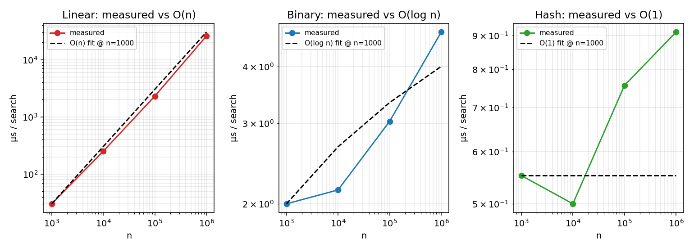

# Task 10 – Theory vs. Experiment (4 marks)

## Operation counts agree almost exactly with the derivations
| Quantity (n = 10⁶) | Theory | Measured |
|---|---|---|
| Linear worst (unsuccessful) | n = 1,000,000 | 1,000,000 |
| Linear average (successful) | (n+1)/2 = 500,000.5 | 483,964 (≈3 % low; 40 random queries only) |
| Binary worst | ⌊log₂ n⌋ + 1 = 20 | 19.95 |
| Binary average (successful) | log₂ n − 1 ≈ 18.9 | 18.91 |
| Hash successful | 1 + α/2 = 1.375 | 1.40 |
| Hash unsuccessful | α = 0.75 | 0.79 (0.74–0.79 for all n) |
| Sort + build | n log n / n | 0.41 s vs 1.88 s: ratio sort(10⁶)/sort(10⁵) = 12.5 (theory 12.0 for n log n); build ratio = 21.9 (theory 10) |

The **comparison counts confirm the mathematical analysis**: linear grows ×1000 for ×1000 data, binary grows ≈ +10 comparisons for ×1000 data, hash stays at ≈ 1.4.

## Wall-clock times: same ordering, small deviations
| Algorithm | n = 10³ → 10⁶ time ratio (average) | Theoretical ratio |
|---|---|---|
| Linear | 30.3 µs → 25,864 µs = **×854** | ×1000 |
| Binary | 2.00 µs → 4.76 µs = **×2.4** | ×2 (log₂10⁶ / log₂10³) |
| Hash | 0.55 µs → 0.91 µs = **×1.7** | ×1 |

**Which scales better?** Hash ≻ Binary ≻ Linear for searching; at n = 10⁶ an average search is ≈ 28,000× faster with hash and ≈ 5,400× faster with binary search than with linear search.

## Differences and likely reasons
1. **Linear slightly sub-linear (×854 instead of ×1000):** the small list (n = 10³) is dominated by fixed per-call overhead (function call, timer loop) which is a larger share of its 30 µs; at 10⁶ the cost is memory-bound and purely proportional to n. Worst-case unsuccessful searches at 10⁶ cost 65 ms vs. 25.9 ms average (×2.5, theory ×2) because unsuccessful scans always read the complete list from memory, whereas averages are over early exits that stay in cache.
2. **Binary grows by ×2.4 rather than ×2, hash is not perfectly flat:** at 10³–10⁴ records the whole array/table fits in the CPU caches; at 10⁶ the data (tens of MB of Python objects) exceeds L2/L3 cache, so every probe (each of the ~19 binary probes, and the bucket access of the hash) risks a **cache miss** costing ~100 ns – the RAM-access model "every operation costs the same" is violated. Asymptotic notation hides this cost; the operation *counts* are unaffected.
3. **Absolute times are inflated by the Python interpreter** (≈ 50–100 ns per bytecode); the recursive binary search pays a function call per probe (iterative cross-check: 2.64 µs vs 4.76 µs at 10⁶). A compiled implementation would be 10–50× faster in absolute terms but the *ratios between algorithms* and the growth rates remain.
4. **Hash misses faster than hits** (0.62 µs vs 0.91 µs at 10⁶): ≈ 47 % of buckets are empty (Poisson, α = 0.75) so many unsuccessful searches stop after reading one pointer.
5. **Timing noise:** microsecond-scale measurements vary by ±10–20 % (best-case column at n = 10⁶ for linear shows 0.45 µs vs 0.17 µs elsewhere – a cold cache effect, not an algorithmic one).
6. **Hash build ratio 21.9 vs expected 10** for n 10⁵ → 10⁶: allocation of 1.33 M Python lists and cache-unfriendly random writes make the per-element insertion cost grow with n; the algorithm is still linear in operations (n insertions) but the constant factor is not constant on real hardware.

**Conclusion:** experiments confirm the theoretical growth rates Θ(n), Θ(log n) and Θ(1) in operation counts and, within explainable hardware effects, in time.
