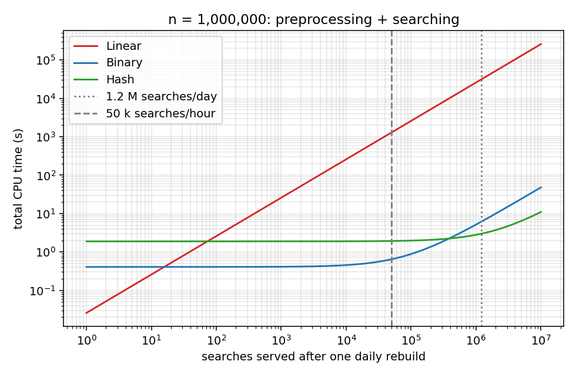

# Task 12 – Day-4 Design Challenge (8 marks)

**New requirement:** 50,000 searches per hour on 1,000,000 records; new records are added **once per day**.

Derived load: 50,000 / 3,600 s ≈ **13.9 searches/s** (one every 72 ms), **1.2 million searches/day**.

---
## A. Impact analysis (2 marks)
**What has changed.** The original problem said nothing about *how many* searches occur or how often data changes; the recommendation in Task 11 was a general-purpose balance. We now know the workload is **read-dominated**: 1.2 M searches vs. one batch update per day (ratio > 10⁶ : 1).

**Assumptions affected.**
1. "Preprocessing is a one-off cost that must be justified against a few searches" → now it is **amortised over 1.2 million searches/day**; a preprocessing step of a few seconds costs ≈ 2 µs per search.
2. "Inserts might be frequent, so keep the structure flexible" → inserts are *batch, daily*, so the index can be **rebuilt offline** and swapped in; no need for dynamic-insert capability.
3. "Latency per query is a nicety" → with a continuous stream of requests, per-search cost multiplies by 1.2 M/day and decides the hardware needed.

**Why search frequency matters.** Total work = preprocessing + q × (cost per search). With q = 1.2 × 10⁶ per day, the per-search term dominates every other term, so a constant-factor improvement in search cost (not just an asymptotic one) matters.

**Why infrequent updates matter.** The expensive part of the faster structures (sort, hash build) is incurred once per day, and the structure is **read-only** the rest of the time, so no locking or dynamic resizing is needed and concurrent readers need no synchronisation.

---
## B. Evaluation of the original design (2 marks)
Original recommendation: sorted array + binary search (Task 11). Measured data for n = 10⁶:

| Quantity | Linear | Binary (original) | Hash |
|---|---|---|---|
| Preprocessing (once/day) | 0 | 0.407 s | 1.883 s |
| Avg. search | 25,864 µs | 4.756 µs | 0.911 µs |
| CPU for 50,000 searches (1 hour) | **1,293 s** (36 % of one core) | **0.238 s** | **0.046 s** |
| CPU for 1.2 M searches (1 day) incl. preprocessing | **31,037 s** (≈ 8.6 h) | **6.1 s** | **3.0 s** |

* **Expected behaviour under 50,000/h:** binary search needs 0.24 s of CPU per hour (0.007 % of one core) – it **easily meets** the requirement; latency ≈ 5 µs per lookup. (Linear would burn 36 % of a core with 26–65 ms latency in this implementation and would not scale if traffic or n grew.)
* **Is preprocessing acceptable?** Yes: 0.41 s once a day (≈ 0.3 µs per search); 1.9 s for hash. Both fit trivially in a nightly window.
* **Could another approach give better overall performance?** Yes – the hash index: at q = 1.2 M/day it has the lowest total daily cost (3.0 s vs 6.1 s). Break-even between hash and binary: (1.883 − 0.407 s) / (4.756 − 0.911 µs) ≈ **384,000 searches**, which the workload exceeds within **≈ 7.7 hours**; below that the sort is cheaper. (Graph: `Report/Tables_and_Graphs/task12_total_cost.png`.)

---
## C. Adaptation or redesign (2 marks)
**Decision: MODIFY** – promote Approach 3 (hash index) to the primary lookup path, and keep Approach 2's sorted array as the master copy and fallback.

**Revised strategy**
1. **Master copy:** sorted array of registration numbers (as before). Once per day, take the k new records, sort them (Θ(k log k)) and **merge** with the existing array in Θ(n + k) – no need to re-sort 10⁶ records from scratch.
2. **Index:** after the merge, build a fresh hash table (chaining, α ≤ 0.75, expected Θ(n + k)) off-line, then **atomically swap** it in (double buffering). Searches never see a half-built index.
3. **Search path:** hash lookup, expected Θ(1). Ordered/range queries and any consistency checks use the sorted array (Θ(log n)).

**What changed vs. the original design:** the lookup structure (hash instead of binary search), the update procedure (batch merge + rebuild instead of "sort once"), and the system becomes read-only between updates.

**Effect on complexity**
| | Original | Modified |
|---|---|---|
| Search (average) | Θ(log n) ≈ 19–20 comparisons | **Θ(1)** expected ≈ 1.4 comparisons |
| Daily preprocessing | Θ(n log n) (full re-sort) | Θ(n + k) merge + Θ(n + k) hash build |
| Search (worst) | Θ(log n) | O(n) in theory (degenerate hash), 7 observed; **fallback** to binary search bounds it to Θ(log n) if a chain exceeds a threshold |
| Daily total, q = 1.2 M | 0.41 s + 1.2M · 4.76 µs = 6.1 s | 1.88 s + 1.2M · 0.91 µs = 3.0 s |
| Memory | n | ≈ 2.3 n (array + buckets) |

---
## D. Evidence-based defence (2 marks)
1. **Mathematical:** per-search cost Θ(1) vs Θ(log n); total daily cost Θ(n + q) vs Θ(n log n + q log n). With n = 10⁶, q = 1.2 × 10⁶/day: 19.9 comparisons × q = 2.4 × 10⁷ vs 1.4 × q = 1.7 × 10⁶ (14× fewer comparisons).
2. **Experimental (Task 9):** measured 0.91 µs vs 4.76 µs per search (5.2× faster); total daily CPU 3.0 s vs 6.1 s; both fit easily within capacity, so the decision is about margin and scalability, not feasibility.
3. **Search frequency:** the hash index overtakes binary search after ≈ 384,000 searches; the workload delivers that in 7.7 hours, i.e. the extra preprocessing is repaid within the day. If the rate dropped below ≈ 16,000/hour (384,000/24 h) the sorted array alone would be cheaper in total – a simple monitoring rule.
4. **Preprocessing:** 1.9 s per day (once, off-peak) vs 0.4 s for the sort: its **amortised cost is 1.6 µs per search** – negligible next to the 3.85 µs saved per search.
5. **Dataset size:** the advantage grows with n (binary adds one comparison per doubling; hash adds none) and with traffic; at 10⁷ records the sort alone would take ≈ 5 s and each search ≈ 23 comparisons.
6. **Trade-offs accepted:** ≈ 2.3× memory, only expected-case O(1) (mitigated by the binary-search fallback and by monitoring max chain length), no range queries in the hash (served by the sorted array), more complex daily rebuild. **Linear search rejected:** 1,293 CPU-seconds per hour (36 % of a core) and 26–65 ms latency, growing linearly with n.
7. **Honest caveat:** at only 13.9 requests/s even the original binary-search design is more than adequate (0.007 % of a core). The modification is justified by lower total cost, scalability headroom (traffic growth ×10–100) and constant-time lookups, **not** because the original design fails. If simplicity and ordered queries were the priority, *retaining* the original design would also be defensible.

**Final decision:** MODIFY – sorted array master + nightly-rebuilt hash index, with binary search as ordered-query path and fallback.
