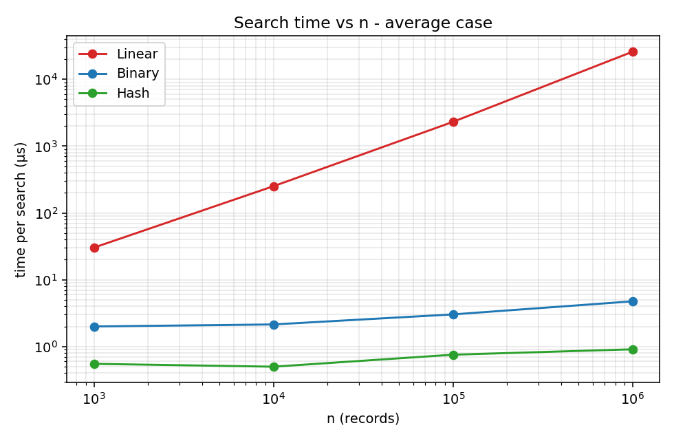
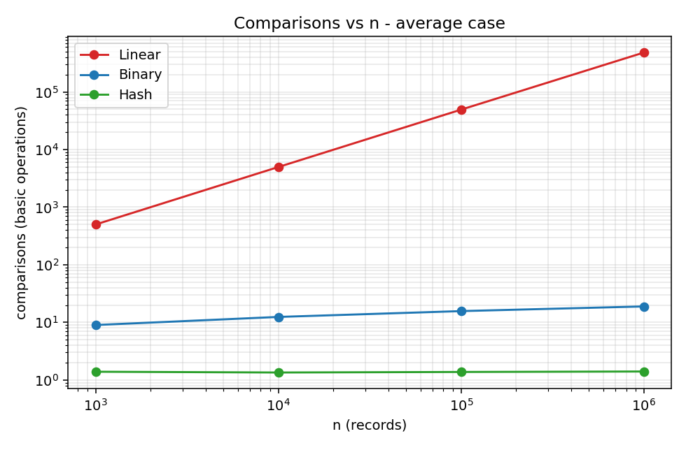
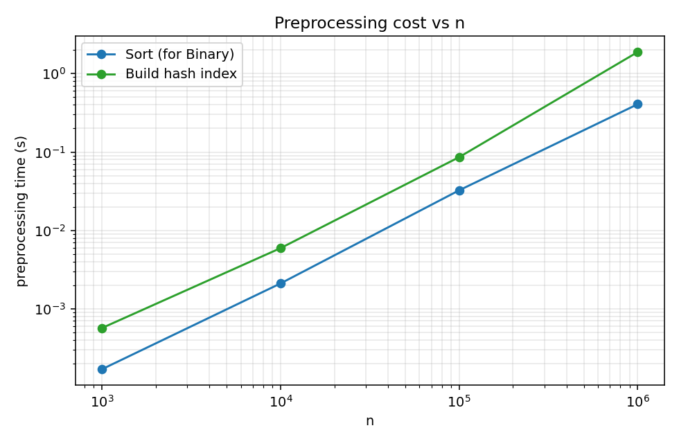

# Task 9 – Experimental Performance (3 marks)

Measured on the assignment machine (CPython 3.12). Times are **mean µs per single search**; "cmp" is the exact mean count of the basic operation. Raw data: `results.csv`. All figures are in `Report/Tables_and_Graphs/`.

### Best case

| n | Linear cmp | Binary cmp | Hash cmp | Linear µs | Binary µs | Hash µs |
|---:|---:|---:|---:|---:|---:|---:|
| 1,000 | 1.0 | 1.00 | 1.00 | 0.17 | 0.27 | 0.33 |
| 10,000 | 1.0 | 1.00 | 1.00 | 0.21 | 0.22 | 0.28 |
| 100,000 | 1.0 | 1.00 | 1.00 | 0.18 | 0.22 | 0.28 |
| 1,000,000 | 1.0 | 1.00 | 1.00 | 0.45 | 0.23 | 0.33 |

### Average case

| n | Linear cmp | Binary cmp | Hash cmp | Linear µs | Binary µs | Hash µs |
|---:|---:|---:|---:|---:|---:|---:|
| 1,000 | 500.5 | 8.99 | 1.39 | 30.30 | 2.00 | 0.55 |
| 10,000 | 4,978.7 | 12.41 | 1.35 | 251.38 | 2.15 | 0.50 |
| 100,000 | 49,371.7 | 15.68 | 1.38 | 2,308.32 | 3.03 | 0.76 |
| 1,000,000 | 483,964.1 | 18.91 | 1.40 | 25,864.09 | 4.76 | 0.91 |

### Worst case

| n | Linear cmp | Binary cmp | Hash cmp | Linear µs | Binary µs | Hash µs |
|---:|---:|---:|---:|---:|---:|---:|
| 1,000 | 1,000.0 | 9.97 | 0.76 | 49.20 | 2.12 | 0.34 |
| 10,000 | 10,000.0 | 13.37 | 0.79 | 479.62 | 2.35 | 0.38 |
| 100,000 | 100,000.0 | 16.67 | 0.74 | 5,294.10 | 3.13 | 1.01 |
| 1,000,000 | 1,000,000.0 | 19.95 | 0.79 | 65,293.86 | 4.74 | 0.62 |

### Preprocessing cost

| n | Linear | Sort (Binary) | Build hash index |
|---:|---:|---:|---:|
| 1,000 | 0 | 0.0002 s | 0.0006 s |
| 10,000 | 0 | 0.0021 s | 0.0060 s |
| 100,000 | 0 | 0.0325 s | 0.0860 s |
| 1,000,000 | 0 | 0.4070 s | 1.8832 s |

Notes: (a) Hash "worst" (unsuccessful) comparisons are < 1 because ≈ 47 % of buckets are empty (no comparison at all). (b) Binary iterative cross-check: 1.09 µs → 2.64 µs per search (n = 10³ → 10⁶), about 2× faster than the recursive version in CPython because of function-call overhead – same comparison counts. (c) Maximum hash chain length = 7 at every size.

## Graphs
| Figure | File |
|---|---|
| Comparisons vs n (best / average / worst) | `comparisons_best.png`, `comparisons_average.png`, `comparisons_worst.png` |
| Search time vs n (best / average / worst) | `time_best.png`, `time_average.png`, `time_worst.png` |
| Preprocessing time vs n | `preprocessing.png` |
| Measured vs theoretical growth | `theory_vs_experiment.png` |
| Total cost (preprocessing + searches) for n = 10⁶ | `task12_total_cost.png` |

